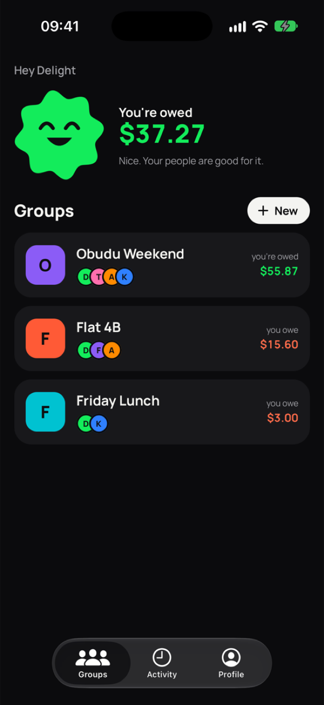
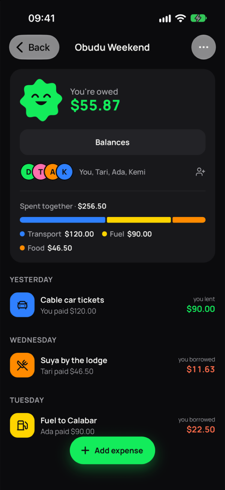
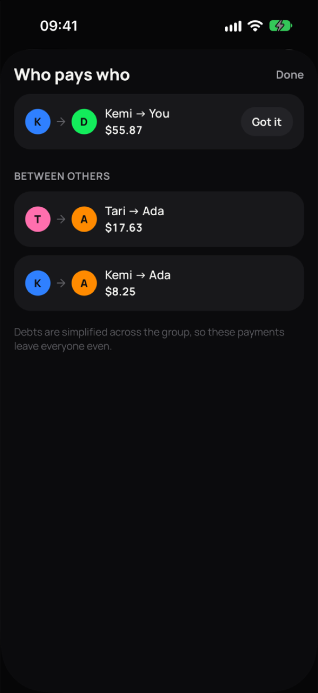
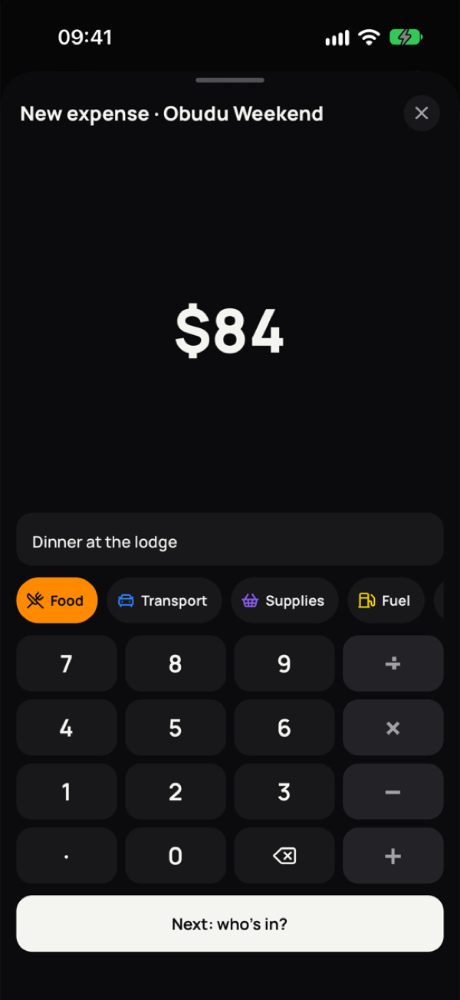
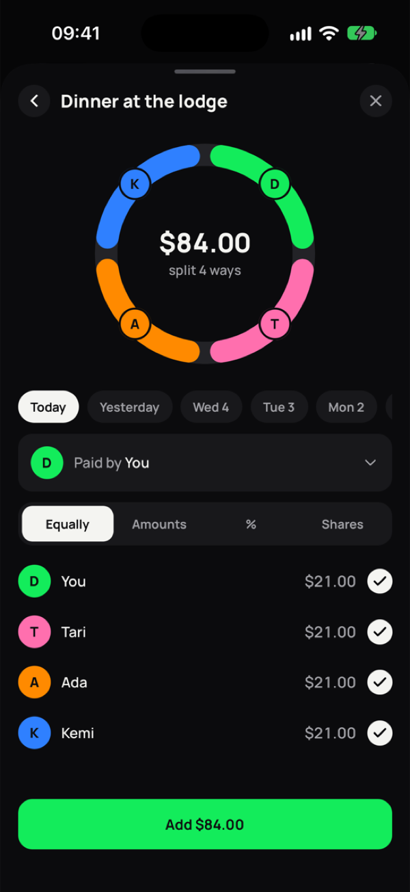
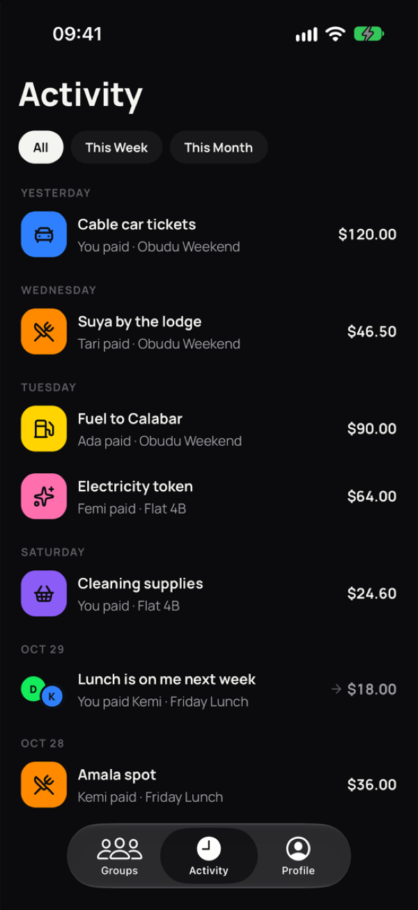

# Split the Cost

An iOS and Android app for sharing costs with friends: trips, flats, dinners. Add what you spent, and it works out who owes whom with as few payments as possible.

<p align="center">
  
  
  
</p>
<p align="center">
  
  
  
</p>

## What it does

- **Groups** with their own currency (USD, NGN, EUR, GBP, GHS, KES, ZAR, CAD). Invite people by link or by email.
- **Expenses** split four ways: equally, by exact amounts, by percentage or by shares. One person can pay, or several can each pay part of it.
- **Balances** that net everything out and suggest the fewest payments that settle the group.
- **Payments** in both directions: record what you paid someone, or mark a payment you received. Long-press a payment to undo it.
- **Sheets for creating things.** Adding a group, an expense or a payment opens over the screen you came from.
- **Moodlings**, small Rive characters that show at a glance whether you're owed, settled or owing. A few things are hidden in the app for people who tap around.
- **Account controls:** edit your profile, delete your account, and read the privacy policy in the app.

## Stack

- Expo SDK 58, React Native 0.88, React 19 with the React Compiler
- expo-router with native form sheets
- Reanimated 4 and Gesture Handler
- NativeWind for styling, Manrope for type
- React Query for server state, React Hook Form and Zod for forms
- Rive for the Moodlings and the success burst
- Vitest for the domain and mock API tests

## Getting started

The app uses a native Rive module, so it runs in a development build, not Expo Go.

```bash
npm install
npx expo run:ios      # or: npx expo run:android
```

After the first build, `npm start` is enough to reload JavaScript changes.

### Mock API

By default every request goes to a mock of the API inside the app (`src/services/mock`), which keeps its data in AsyncStorage. Sign-in is simulated, so any password works.

Demo accounts:

- `you@example.com`
- `tari@example.com`

To use the real backend instead, set these before starting:

```bash
EXPO_PUBLIC_USE_MOCK_API=0
EXPO_PUBLIC_API_URL=https://split-the-cost-api.onrender.com
```

### Deep links

- `splitthecostapp://group/<id>` opens a group
- `splitthecostapp://join/<code>` opens an invite

## Scripts

```bash
npm test             # vitest
npm run typecheck    # tsc --noEmit
npm run lint         # expo lint
```

## Project structure

```
app/                    Screens (expo-router)
  (public)/             Onboarding, sign in, register
  (app)/(tabs)/         Groups, activity, profile
  (app)/group/          Group detail and the create sheet
  (app)/expense/        Expense detail and the add/edit sheet
  (app)/settle.tsx      Record a payment
  (app)/join/[code].tsx Accept an invite
  privacy.tsx           Privacy policy, reachable signed in or out
src/
  domain/               Money, splits, balances and debt simplification (pure, tested)
  services/             API client and per-resource services
  services/mock/        The mock API and its database
  ui/                   Shared components (Moodling, Keypad, SheetHeader, ...)
  content/              Copy for the privacy and help pages
  theme/                Colour tokens and theme provider
rive/splitit/           Source for the Rive scenes and the app icons
docs/screenshots/       The screenshots in this README
```

Amounts are integer cents everywhere. All the splitting maths lives in `src/domain`, so it's tested without the app.

### Rive and icons

The Moodlings and confetti are generated rather than drawn by hand:

```bash
cd rive/splitit
python3 generate.py   # writes scene.rml
rive . --verify       # checks it compiles with the Rive CLI
python3 art.py        # draws the splash screen and app icons
```

The app loads the compiled scenes from `assets/rive/splitit.riv`, so rebuild that file from `scene.rml` with the Rive CLI after changing the scenes.

## Builds

EAS profiles are in `eas.json`:

| Profile       | Use                         | API      |
| ------------- | --------------------------- | -------- |
| `development` | Dev client on the simulator | Mock     |
| `preview`     | Internal test builds        | Mock     |
| `production`  | Store builds                | Real API |

```bash
eas build --profile preview --platform ios
```

## Privacy

The app collects only what it needs to work: your name, your email, and the groups and expenses you add. There's no analytics or tracking. The full policy is in `src/content/pages.ts`, and in the app under Profile → About.
